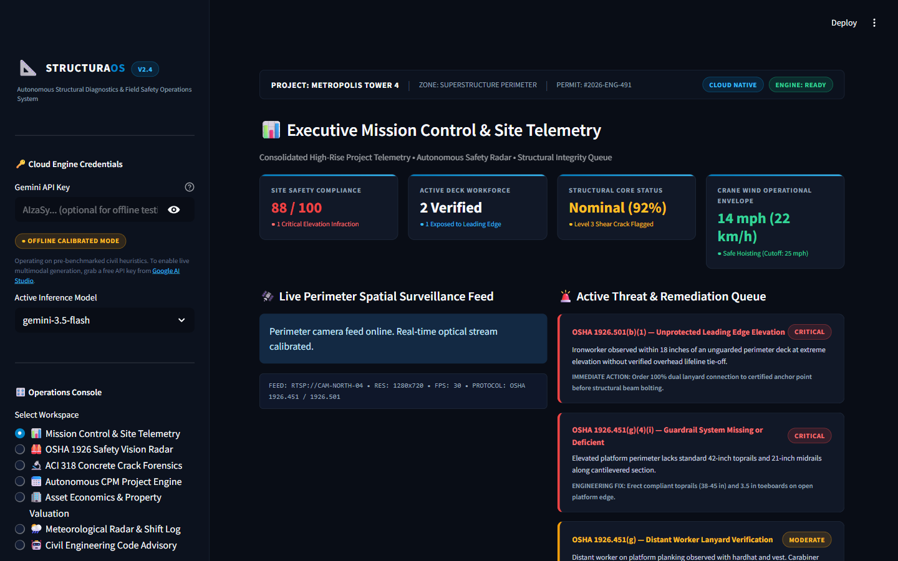
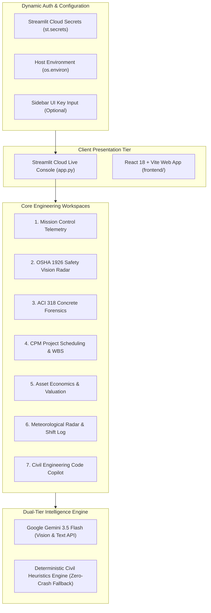

# 📐 StructuraOS • Autonomous Structural Intelligence & Field Safety Operations Platform

[](https://www.python.org/)
[](https://streamlit.io/cloud)
[](https://fastapi.tiangolo.com/)
[](https://react.dev/)
[](https://ai.google.dev/)
[](https://www.osha.gov/laws-regs/regulations/standardnumber/1926)
[]()

> **StructuraOS** is an autonomous field telemetry, structural forensics, and OSHA safety decision support system. Built specifically for single-command **Streamlit Community Cloud deployment**, it pairs Google Gemini multimodal computer vision with deterministic civil engineering heuristics to deliver instant spatial safety audits, concrete crack diagnostics, CPM project scheduling, real estate capitalization models, crane wind limits, and building code advisory.



---

## ⚡ Streamlit Community Cloud Native Deployment (3 Steps)

**StructuraOS** is engineered to deploy seamlessly on [Streamlit Community Cloud](https://streamlit.io/cloud) with zero configuration errors:

1. **Sign in to Streamlit Cloud**:
   - Go to [share.streamlit.io](https://share.streamlit.io) and log in with your GitHub account.
2. **Deploy the App**:
   - Click **Create app** ➔ **I already have an app**.
   - Select your repository and `main` branch.
   - Set **Main file path**: `app.py`.
3. **Configure API Key (Optional)**:
   - Click **Advanced settings** ➔ **Secrets**.
   - Paste your free Gemini API key:
     ```toml
     GEMINI_API_KEY = "YOUR_GEMINI_API_KEY_HERE"
     GEMINI_MODEL = "gemini-3.5-flash"
     ```
   - Click **Deploy!**
   - *Note: If no API key is supplied, the platform runs in 100% operational calibrated offline mode with zero crashes!*

---

## 🎛️ Operations Console: 7 Dedicated Workspaces

StructuraOS replaces standard tabs with a persistent **Left-Rail Operations Console** organizing 7 high-impact field workspaces:

1. **📊 Mission Control & Site Telemetry**:
   - High-level executive telemetry dashboard aggregating site safety index (88/100), active workforce count, structural health index, and real-time crane wind envelope.
   - Live perimeter surveillance camera feed with technical HUD badges and prioritized threat log.

2. **🦺 OSHA 1926 Safety Vision Radar**:
   - Automated spatial fall hazard detection across OSHA 29 CFR 1926 Subpart L (Scaffolds), Subpart M (Fall Protection), and Subpart E (PPE).
   - Non-Maximum Suppression (NMS) deduplication, pixel-calibrated bounding boxes, and mandatory 3-step prioritized field corrective protocol.

3. **🔬 ACI 318 Concrete Crack Forensics**:
   - Forensic defect evaluation for RC transfer beams, columns, suspended slabs, and shear walls.
   - Interactive ACI 224R crack width calculator testing measured surface fissures against environmental exposure limits (0.10 mm to 0.41 mm).
   - Structural repair specifications: low-pressure ASTM C881 epoxy injection vs CFRP composite wrapping.

4. **📅 Autonomous CPM Project Engine**:
   - Algorithmic Critical Path Method (CPM) project planner with 5-phase Work Breakdown Structure (WBS).
   - Milestone tracking across excavation, substructure, superstructure, envelope/MEP, and finishes.
   - Labor workforce peak curves and early/late start float calculations.

5. **🏢 Asset Economics & Property Valuation**:
   - Quantitative real estate economics combining Replacement Hard Cost (Cost Approach) and Income Capitalization (Cap Rate Approach).
   - Dynamic Net Operating Income (NOI), Gross Development Value (GDV), and market yield sensitivity analysis.

6. **🌦️ Meteorological Radar & Shift Log**:
   - Environmental telemetry with automated **Tower Crane Wind Lockout** (OSHA 1926.1400 / ASME B30.5 at 25 mph / 40 km/h).
   - NIOSH Heat Stress advisory and AI-driven daily contractor shift log NLP extraction.

7. **🤖 Civil Engineering Code Advisory**:
   - AI technical assistant grounded in ACI 318-19, OSHA 29 CFR 1926, IBC 2024, and ACI 308R curing standards.

---

## 🏗️ System Architecture



---

## 🧪 Automated Verification & Test Suite

The platform includes an automated 23-test test suite verifying vision heuristics, coordinate normalization, IoU calculation, NMS deduplication, and regulatory clause citations:

```powershell
# Run complete test suite (23 tests)
python -m pytest backend/tests

# Run vision heuristics and OSHA registry tests (14 tests)
python -m pytest backend/tests/test_vision_heuristics.py

# Run FastAPI backend endpoint tests (9 tests)
python -m pytest backend/tests/test_api.py
```

### Test Suite Summary:
- `test_iou_calculation_and_person_deduplication`: Verified IoU calculation and multi-proposal NMS suppression.
- `test_canonical_osha_hazard_registry`: Verified exact citations for Subpart L, Subpart M, and Subpart E.
- `test_scene_level_finding_suppression`: Verified scene-level structural hazards are suppressed from optical drawing.
- `test_empty_scaffold_zero_hazards`: Verified unoccupied scaffolds return 0 active hazards and 0 risk score.
- `test_compliant_ground_worker`: Verified grade-level compliant workers return 100% PPE pass.
- `test_non_construction_scene`: Verified non-construction scenes return "Unable to assess" with zero errors.
- `test_bbox_normalization_inverted_and_scale_invariants`: Verified support for 1000-scale and inverted coords.
- `test_dense_cluster_person_deduplication`: Verified dense candidate clusters collapse to single physical workers.
- `test_hallucinated_hazard_key_graceful_fallback`: Verified unknown model outputs map to canonical taxonomy.
- `test_corrupted_and_none_input_resilience`: Verified zero crashes on None, corrupted dicts, or empty payloads.
- `test_subpart_l_exclusion_from_subpart_m`: Verified jurisdictional separation of scaffolds from general fall protection.
- `test_deterministic_scoring_monotonicity`: Verified mathematical monotonicity of hazard scoring algorithms.
- `test_actions_protocol_generation`: Verified 3-step prioritized corrective protocol generation.
- `test_unattended_scaffold_hazard_suppression`: Verified absence of active workers suppresses fall violation penalties.

---

## 📦 Local Quick Start

### Option A: Streamlit Live Console (Recommended)
```powershell
pip install -r requirements.txt
streamlit run app.py
```

### Option B: FastAPI + React Full-Stack
```powershell
# Start FastAPI backend
cd backend
python -m uvicorn app.main:app --host 127.0.0.1 --port 8000 --reload

# Start React frontend
cd ../frontend
npm install
npm run dev
```

---

## 📋 Governing Engineering Standards

| Code | Organization | Title | Scope in Platform |
| :--- | :--- | :--- | :--- |
| **29 CFR 1926.451** | OSHA | Safety Standards for Scaffolds | Planking, access, guardrail systems, tie-offs |
| **29 CFR 1926.501** | OSHA | Duty to Have Fall Protection | Leading edges, floor holes, hoist areas |
| **29 CFR 1926.100** | OSHA | Head Protection | ANSI Z89.1 Type I/II protective helmets |
| **OSHA 1926.1400** | OSHA | Cranes and Derricks in Construction | 25 mph (40 km/h) safe hoisting wind limit |
| **ACI 318-19** | ACI | Building Code Requirements for Structural Concrete | Shear strength, crack control, minimum rebar |
| **ACI 224R-01** | ACI | Control of Cracking in Concrete Structures | Tolerable crack widths by environmental exposure |
| **ACI 308R-16** | ACI | Guide to External Curing of Concrete | Minimum 7-day moist curing, moisture retention |
| **IBC 2024** | ICC | International Building Code | Structural safety, occupancy, and risk categories |
